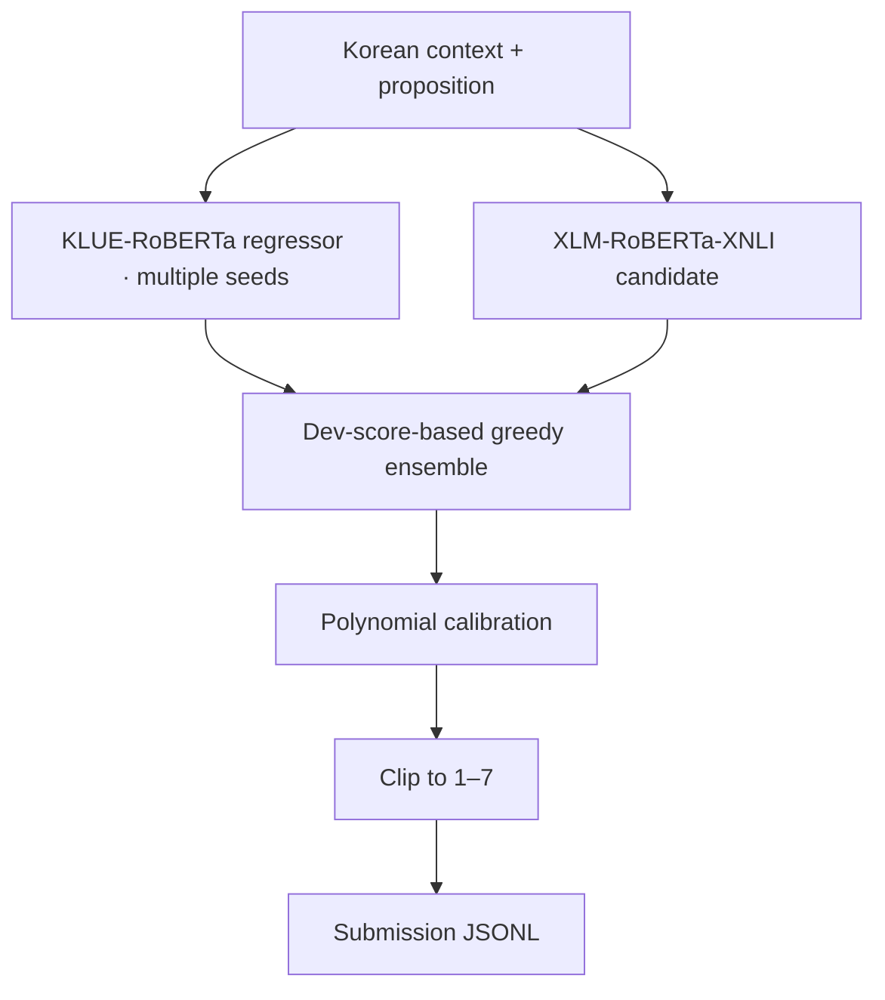

# 📐 Certainty Inference

### Korean Natural Language Inference · Confidence Regression

**Predicting certainty from context and a proposition.**  
국립국어원 말평 확신성 추론 과제 — Transformer 회귀, 앙상블, 보정 실험

[Problem](#task) · [Approach](#approach) · [Result](#reported-result) · [Code](#repository-guide) · [Notes](#limitations)

---

## Task

문맥(\`context\`)과 명제(\`prompt\`)가 주어졌을 때, 해당 명제를 얼마나 확신할 수 있는지를 **1부터 7 사이의 실수**로 예측하는 회귀 문제입니다.

| Input | Output |
|:--|:--|
| Context + target proposition | Certainty score \`1.0–7.0\` |
| Training: **1,448** examples | Supervised regression |
| Development: **189** examples | Model selection and calibration |
| Test: **180** examples | Submission format |

**Evaluation:** MSE 기반. 주최 측 표시 점수와 자체 MSE 계산값은 구분해 해석해야 합니다.

## Approach

**Why an ensemble?**

한 모델의 예측 오차에만 의존하지 않도록 다양한 사전학습 모델과 학습 seed를 비교하고, 검증 데이터 기준으로 결합을 선택했습니다. 예측 분포가 정답 범위에 잘 맞도록 후처리 보정도 실험했습니다.

- **Models:** KLUE-RoBERTa-large, XLM-RoBERTa-large-XNLI 계열
- **Selection:** validation MSE를 이용한 greedy ensemble
- **Calibration:** validation-set polynomial calibration
- **Output:** 공식 점수 범위 \`[1, 7]\`로 clipping

## Reported Result

### \`-0.0757290\`

**Recorded leaderboard display score · wave8**

기존 프로젝트 README에 **공식 리더보드 1위 확인**으로 기록된 결과입니다. 리더보드의 실시간 순위와 점수를 이 README 작성 시점에 독립적으로 재확인한 것은 아니며, 외부에서 재현한 모델 성능이라고 표현하지 않습니다.

- Best submission: [\`submissions/malpyeong_certainty_submission_best_wave8.jsonl\`](submissions/malpyeong_certainty_submission_best_wave8.jsonl)
- Main training script: [\`scripts/train_transformer_regressor.py\`](scripts/train_transformer_regressor.py)
- Ensemble selection: [\`scripts/greedy_ensemble.py\`](scripts/greedy_ensemble.py)
- Calibration: [\`scripts/calibrate_predictions.py\`](scripts/calibrate_predictions.py)

## Repository Guide

| Path | Contents |
|:--|:--|
| [\`data/raw/\`](data/raw/) | 훈련·검증 및 평가 입력 |
| [\`scripts/train_transformer_regressor.py\`](scripts/train_transformer_regressor.py) | Transformer 기반 회귀 학습 |
| [\`scripts/greedy_ensemble.py\`](scripts/greedy_ensemble.py) | 검증 점수 기반 후보 결합 |
| [\`scripts/stack_ensemble.py\`](scripts/stack_ensemble.py) | 추가 ensemble 실험 |
| [\`scripts/calibrate_predictions.py\`](scripts/calibrate_predictions.py) | 예측 분포 보정 |
| [\`scripts/score_submission.py\`](scripts/score_submission.py) | 제출 포맷 및 로컬 평가 |
| [\`reports/\`](reports/) | 분석 결과 |
| [\`docs/task_notes.md\`](docs/task_notes.md) | 과제·데이터·점수 체계 기록 |
| [Original README](docs/README_BEFORE_PORTFOLIO_REFRESH.md) | 기존 실험 메모 |

## Reproduction Notes

학습과 앙상블 재현에는 PyTorch·Transformers 및 모델 다운로드가 필요하며, GPU 사용을 권장합니다. 저장소는 일괄 설치형 패키지보다는 **실험 스크립트와 결과 기록** 중심으로 구성돼 있습니다.

**학습/제출 재현 절차:** 데이터셋 확인 → 회귀 모델 학습 → dev 기반 후보 선정 → 앙상블 → calibration → JSONL 생성. 구체적인 실행 인자와 배치 스크립트는 [\`scripts/\`](scripts/)에서 확인할 수 있습니다.

## Limitations

- Dev 세트 기반 ensemble/calibration은 과적합 가능성이 있습니다.
- 로컬에 저장된 정답 포함 파일은 **분석/제출 검증용**이며, 공식 시험 입력과 학습에 혼합해서는 안 됩니다.
- 기록된 제출 순위는 당시 프로젝트 결과이지 상시 유지되는 리더보드 순위가 아닙니다.
- 모델 체크포인트와 전체 실행환경의 완전한 재현 가능성을 보장하지 않습니다.

---

**From model predictions to better-calibrated confidence estimates.**

[Portfolio ↗](https://ai-pre.github.io/Ai-pre/) · [Project notes ↗](https://app.notion.com/p/36906d3e45248005be06eb9c2414a3af)

